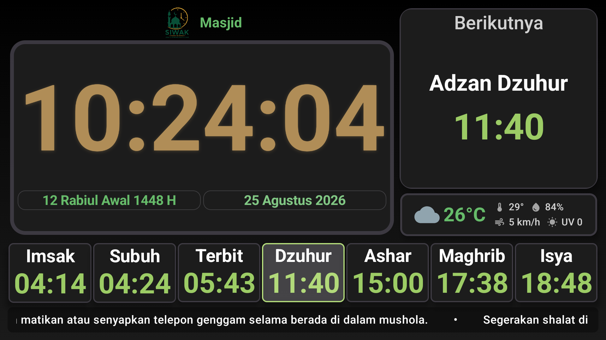
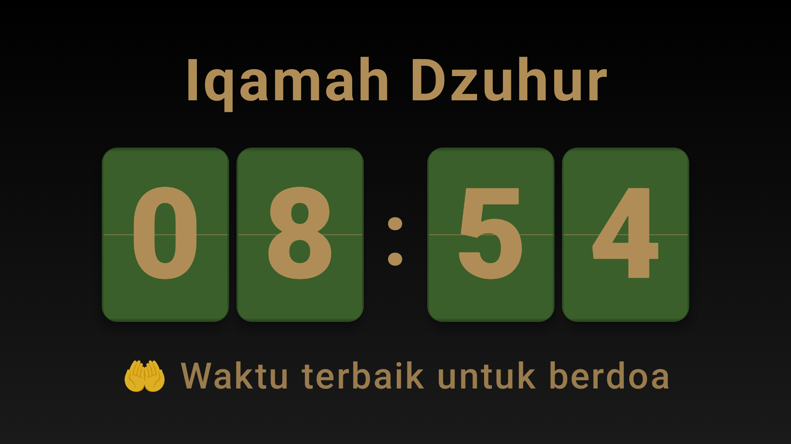
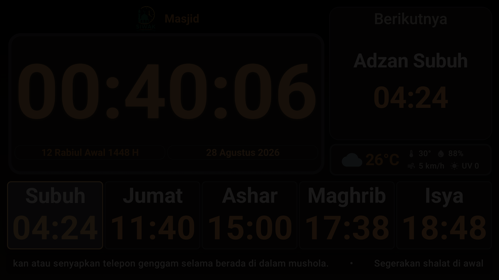

# SIWAK — Jam & Jadwal Shalat untuk Layar Masjid

**SIWAK** (Sistem Informasi Waktu Shalat) adalah aplikasi Android TV untuk menampilkan jam,
jadwal shalat, tanggal Hijriah, cuaca, dan pengumuman berjalan (running text) di layar masjid
maupun musholla. Dirancang untuk layar besar dan navigasi remote (D-Pad), serta **offline-first**
sehingga tetap berjalan meski internet mati.

> Proyek Fakultas Teknik, Universitas Negeri Yogyakarta. Basis: [MosqueClock](https://github.com/mhdzumair/MosqueClock)
> (open-source, Android TV) oleh Mohamed Zumair, diadaptasi penuh untuk Indonesia. Lisensi MIT.

---

## 📸 Tampilan

<table>
  <tr>
    <td width="50%"><br/><sub><b>Layar utama:</b> jam digital, tanggal Hijriah, cuaca, jadwal, running text</sub></td>
    <td width="50%"><br/><sub><b>Tema warna:</b> salah satu dari 11 tema (Amber Sunset)</sub></td>
  </tr>
  <tr>
    <td><br/><sub><b>Jam analog</b> dengan tanggal Hijriah &amp; Masehi</sub></td>
    <td><br/><sub><b>Format 12 jam</b> (AM/PM); Imsak &amp; Terbit dapat disembunyikan</sub></td>
  </tr>
  <tr>
    <td><br/><sub><b>Menuju adzan:</b> hitung mundur (flip clock) &amp; label Adzan/Iqamah</sub></td>
    <td><br/><sub><b>Countdown layar penuh</b> menjelang adzan</sub></td>
  </tr>
  <tr>
    <td><br/><sub><b>Countdown Iqamah;</b> jeda dapat diatur per waktu</sub></td>
    <td><br/><sub><b>Masuk waktu shalat:</b> imbauan silent HP + jam</sub></td>
  </tr>
  <tr>
    <td><br/><sub><b>Layar Jumat:</b> info khutbah berlangsung (bisa dimatikan)</sub></td>
    <td><br/><sub><b>Mode Istirahat Malam:</b> layar redup otomatis (hemat listrik, awetkan TV)</sub></td>
  </tr>
</table>

---

## ✨ Fitur Utama

### 🕌 Jadwal shalat yang akurat
Waktu shalat dihitung dari **koordinat lokasi** memakai **metode Kemenag RI** (AlAdhan, method 20),
bukan jadwal tetap. Pindah kota cukup ganti lokasi, seluruh jadwal menyesuaikan otomatis. Tersedia
**koreksi menit per-waktu** agar sama persis dengan jadwal cetak setempat, serta **jadwal manual** penuh.
Nama waktu memakai istilah Indonesia: Imsak, Subuh, Terbit, Dzuhur, Ashar, Maghrib, Isya. Terbit dan
Imsak dapat disembunyikan lewat sakelar.

### 🗓️ Penanggalan & jam
Tanggal **Hijriah** (hisab) dengan **penyesuaian ±hari** agar cocok pengumuman setempat, ditampilkan
berdampingan dengan tanggal Masehi. Jam tersedia mode **digital** maupun **analog**, format 24 jam atau
12 jam, dengan **ukuran yang dapat diperbesar** supaya terbaca dari kejauhan.

### 🔔 Siklus adzan & iqamah
- **Hitung mundur sebelum adzan** (jumlah menit dapat diatur), lengkap dengan tampilan layar penuh.
- **Suara penanda** yang dapat dipilih: bip/pip nyaring, tik-tik hitung mundur, atau **audio kustom**
  (mis. kumandang azan yang diunggah sendiri).
- **Layar "Telah masuk waktu shalat"** berisi imbauan menyenyapkan HP, tampil selama durasi yang diatur.
- **Hitung mundur Iqamah** dengan jeda per-waktu.
- **Layar Jumat** menampilkan info khutbah berlangsung tanpa hitung mundur, dan **bisa dimatikan** untuk
  musholla yang tidak menyelenggarakan shalat Jumat.

### 🎨 Tampilan & informasi
- **11 tema warna** (Emerald Garden, Classic Mosque, Midnight Blue, Ocean Teal, Royal Purple, dan lainnya).
- **Running text** multi-pesan bergilir untuk pengumuman, hadits, atau imbauan.
- **Cuaca** dari OpenWeatherMap **berbasis koordinat** (satu lokasi dengan jadwal), dengan **ikon lokal
  untuk semua kondisi cuaca** dan **cache offline**.
- **Media** dapat diunggah sendiri: logo masjid dan gambar latar (utama, layar shalat, iqamah).
- **Mode Istirahat Malam** meredupkan layar otomatis pada rentang jam malam untuk menghemat listrik dan
  memperpanjang umur TV.

### 📡 Andal & mudah dirawat
- **Offline-first:** jadwal & cuaca di-cache. Aplikasi **prefetch jadwal 7 hari** dan menyimpan cuaca
  terakhir, jadi tetap tampil saat jaringan tidak stabil, lalu menyegar otomatis begitu online.
- **Self-update** (flavor `github`) mendeteksi rilis baru di GitHub dan memasang pembaruan **tanpa perlu
  menyetel ulang TV**; seluruh pengaturan tetap tersimpan.

---

## 🛠️ Teknologi

- Kotlin + Jetpack Compose (UI) · Leanback (Android TV)
- Hilt (DI) · Room (cache jadwal/hijriah) · DataStore Preferences (pengaturan, **bertahan saat update**)
- Retrofit + Gson (AlAdhan & OpenWeatherMap) · Coil (gambar)
- minSdk 21 · targetSdk/compileSdk 34

---

## 🚀 Build

**Prasyarat: JDK 17** (mis. Microsoft OpenJDK 17). JBR 25 bawaan terlalu baru untuk Gradle 8.13.

```bash
gradlew.bat clean :app:assembleGithubDebug
```

APK debug: `app/build/outputs/apk/github/debug/app-github-debug.apk`

Untuk build rilis yang ditandatangani (untuk update TV), lihat **[SIGNING.md](SIGNING.md)**:

```bash
gradlew.bat clean :app:assembleGithubRelease
```

### Flavor distribusi

| Flavor      | Self-update | Untuk                           |
|-------------|-------------|---------------------------------|
| `github`    | ✅ aktif     | Sideload / distribusi langsung  |
| `playstore` | ❌ nonaktif  | Google Play (kebijakan Google)  |

---

## ⚙️ Pengaturan (via remote TV)

Semua konfigurasi ada di layar Settings, disusun agar mudah diakses remote:

1. **Pengaturan Sistem** (akses cepat di paling atas)
2. **Identitas Masjid:** nama, logo, background, bahasa
3. **Lokasi & Jadwal:** kota/koordinat, metode Kemenag, koreksi menit (on/off), jadwal manual, sembunyikan Terbit/Imsak, penyesuaian Hijriah
4. **Waktu & Countdown:** menit sebelum adzan, jeda iqamah, durasi layar silent HP
5. **Tampilan:** jam digital/analog, ukuran jam, tema warna, running text, Layar Jumat, Mode Istirahat Malam
6. **Suara:** adzan & iqamah (beep / tik-tik / audio kustom)
7. **Cuaca:** API key OpenWeatherMap, sinkronisasi (lokasi mengikuti Lokasi & Jadwal)
8. **Sistem:** Data Management (status cache jadwal/hijriah/cuaca), izin, tentang

### Update tanpa setup ulang

Pengaturan disimpan di **DataStore** yang bertahan lintas update aplikasi. Selama `applicationId`
dan tanda tangan APK **tetap sama** (lihat SIGNING.md), TV yang di-update tidak perlu dikonfigurasi ulang.

---

## 📁 Struktur Kode

```
app/src/main/java/com/mosque/prayerclock/
├── data/
│   ├── model/        # Settings, PrayerTimes, WeatherInfo, enum (SoundType, ClockType, ...)
│   ├── repository/   # SettingsRepository (DataStore), PrayerTimesRepository, WeatherRepository, HijriDateRepository
│   └── service/      # AlAdhan & OpenWeatherMap API, UpdateChecker (GitHub Releases)
├── service/          # SoundManager, PrayerNotificationService (siklus adzan/iqamah)
├── ui/
│   ├── components/    # DigitalClock, AnalogClock, WeatherCard, ...
│   ├── screens/       # MainScreen, SettingsScreen
│   └── theme/         # ColorTheme (11 tema), Theme, Color
└── viewmodel/         # MainViewModel, SettingsViewModel
```

---

## 📜 Lisensi & Kredit

MIT.<br>
Berbasis MosqueClock (open-source) oleh Mohamed Zumair.<br>
Dikembangkan oleh Alfian Yudisurya — Departemen Pendidikan Teknik Elektro, FT UNY.
