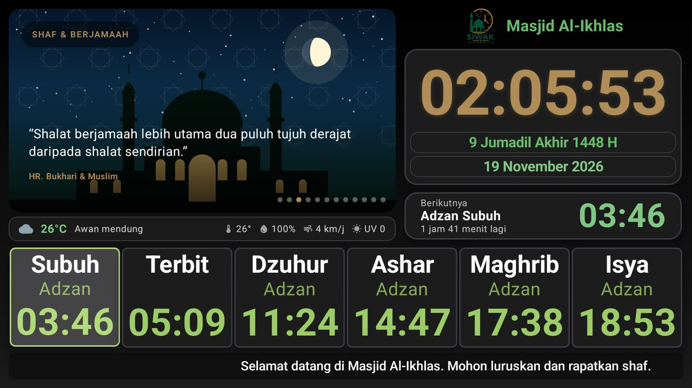
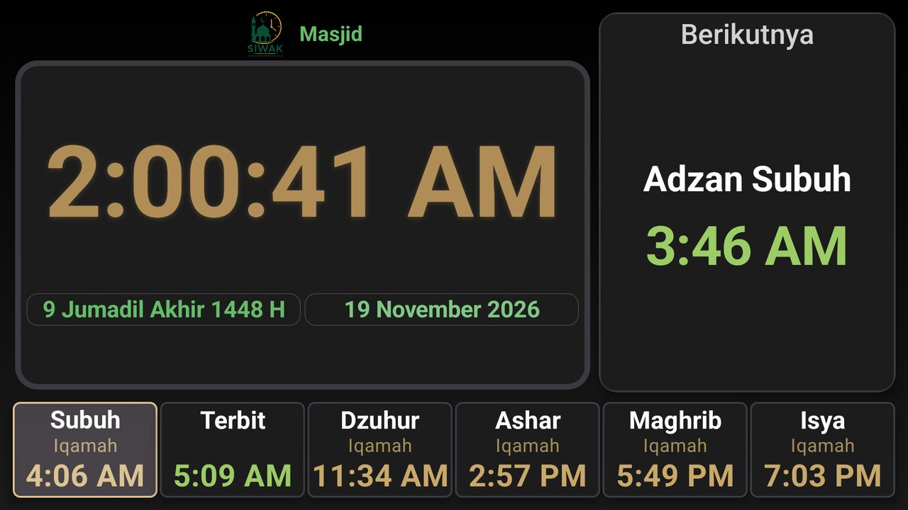
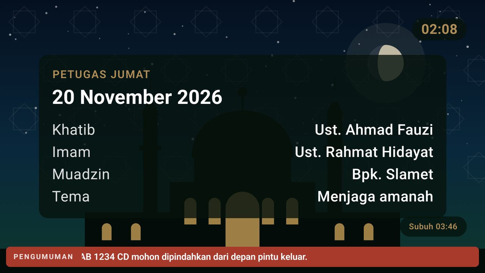
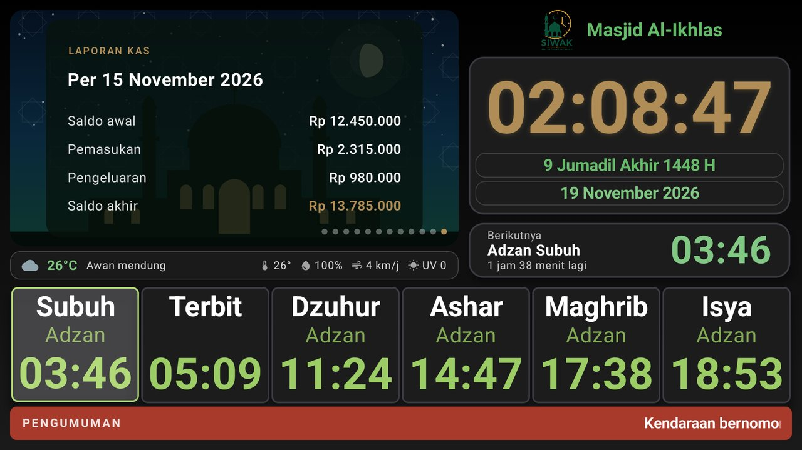
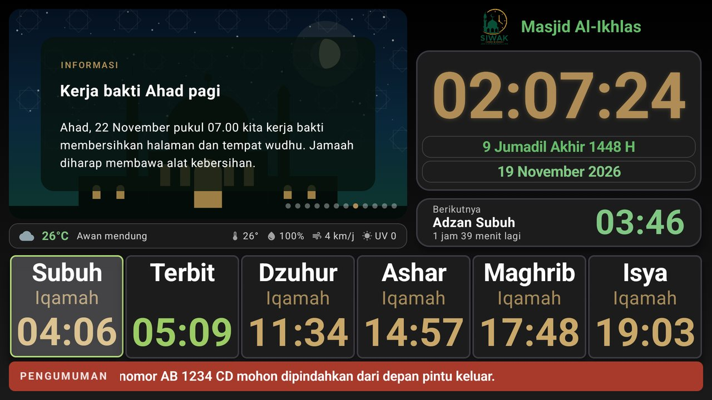
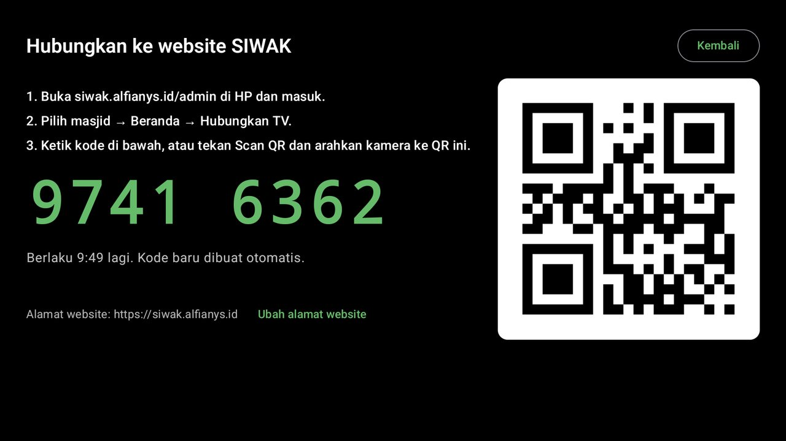
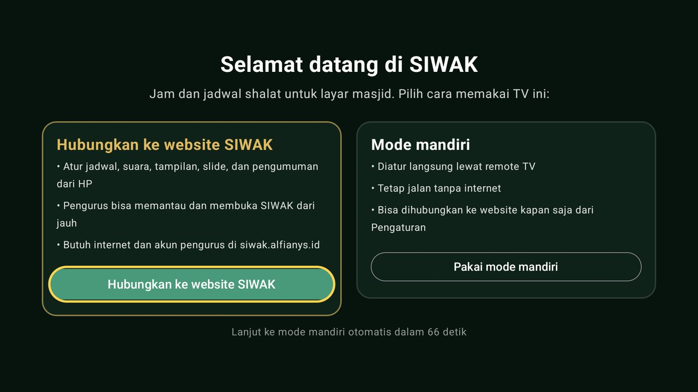
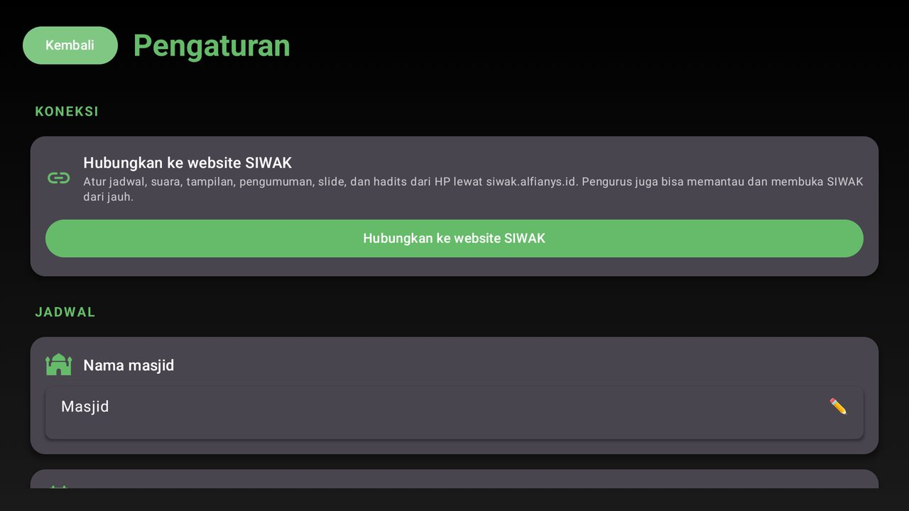
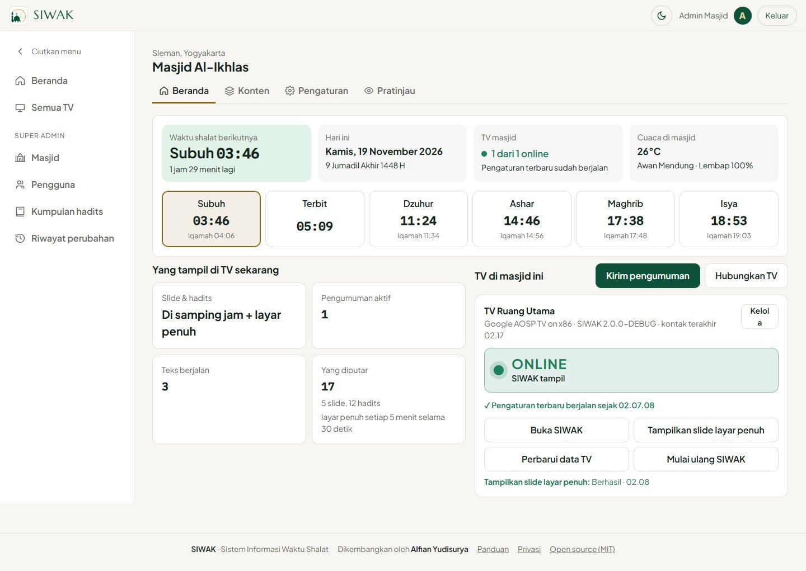

# SIWAK — Jam & Jadwal Shalat untuk Layar Masjid

**SIWAK** (Sistem Informasi Waktu Shalat) adalah aplikasi Android TV untuk layar masjid dan musholla.
Aplikasi ini menampilkan jam besar, jadwal shalat beserta jam iqamah, tanggal Hijriah, cuaca, teks berjalan,
pengumuman, serta slide info masjid dan hadits. Tampilannya dirancang untuk layar besar dan remote (D-Pad),
dan jadwal tetap berjalan walaupun internet putus.

TV bisa dipakai **mandiri** (semua diatur dengan remote, tanpa akun) atau **dihubungkan ke website SIWAK**
(<https://siwak.alfianys.id>) agar pengurus bisa mengatur isi layar dari HP dan memantau setiap TV dari jauh.

**[⬇ Unduh APK terbaru](https://github.com/alfian-yds/siwak/releases/latest)** ·
**[▶ Coba demo layar TV](https://siwak.alfianys.id/demo)** ·
**[Buku panduan (PDF)](https://siwak.alfianys.id/panduan.pdf)** ·
[Panduan online](https://siwak.alfianys.id/panduan) ·
[Server & website](https://github.com/alfian-yds/siwak-server)

---

## 📸 Tampilan

<table>
  <tr>
    <td width="50%"><br/><sub><b>Di samping jam:</b> slide hadits dan info masjid bergantian di sebelah jam dan jadwal</sub></td>
    <td width="50%"><br/><sub><b>Mode mandiri:</b> jam besar, tanggal Masehi &amp; Hijriah, waktu shalat berikutnya</sub></td>
  </tr>
  <tr>
    <td><br/><sub><b>Slide layar penuh:</b> sesekali satu slide memenuhi layar, lalu kembali ke jam</sub></td>
    <td><br/><sub><b>Info masjid:</b> laporan kas, petugas Jumat, agenda, hari besar, informasi, gambar</sub></td>
  </tr>
  <tr>
    <td><br/><sub><b>Pengumuman segera</b> dari HP, tampil bergiliran di bagian bawah layar</sub></td>
    <td><br/><sub><b>Hubungkan TV</b> ke website dengan kode 8 angka atau scan QR</sub></td>
  </tr>
  <tr>
    <td><br/><sub><b>Pemasangan pertama:</b> pilih mode mandiri atau terhubung ke website</sub></td>
    <td><br/><sub><b>Pengaturan dengan remote,</b> urutannya sama dengan menu di website</sub></td>
  </tr>
</table>

<p align="center"><br/>
<sub><b>Website pengurus:</b> jadwal hari ini, status setiap TV, dan perintah jarak jauh</sub></p>

---

## ✨ Fitur

### 🕌 Jadwal shalat
- Dihitung dari **koordinat lokasi** dengan **metode Kemenag RI**, atau diisi manual penuh.
- **Koreksi menit** per waktu agar sama dengan jadwal resmi setempat.
- Nama waktu Indonesia: Imsak, Subuh, Terbit, Dzuhur, Ashar, Maghrib, Isya. Imsak dan Terbit bisa disembunyikan.
- Jadwal disimpan untuk **7 hari ke depan**, sehingga tetap tampil saat internet putus.

### 🔔 Adzan, iqamah, dan Jumat
- **Hitung mundur** menuju adzan (bisa layar penuh) dan hitung mundur **iqamah** dengan jeda per waktu.
- Suara penanda: **tik-tik**, **bip**, atau **audio sendiri** (rekaman yang diunggah), lengkap dengan tombol tes suara.
- **Layar waktu shalat** berisi imbauan menyenyapkan HP, **layar khutbah Jumat** (bisa dimatikan untuk musholla),
  dan **bayan malam Jumat**.

### 🖼️ Isi layar
- **Teks berjalan** multi-pesan; pesan pendek pun tetap berjalan.
- **Slide** info masjid: informasi, laporan kas, petugas Jumat, agenda kegiatan, hari besar, dan gambar,
  dengan urutan, lama tampil, serta hari dan jam tayang yang bisa diatur.
- **Hadits otomatis** dari kumpulan hadits terverifikasi, diacak setiap hari, atau hadits milik masjid sendiri.
- Dua cara tampil: **di samping jam** dan **sesekali satu layar penuh**, dengan gambar masjid di latar slide.
- **10 tema warna**, logo dan gambar latar sendiri, jam 12/24 jam, **cuaca**, dan **mode malam** yang meredupkan layar.
- **Redup pada hari tertentu:** akhir pekan, tanggal merah dan cuti bersama (SKB 3 Menteri), atau tanggal pilihan, dengan
  pilihan tetap terang saat waktu shalat. Cocok untuk musholla yang sepi pada hari libur.

### 🌐 Terhubung ke website
- **Semua diatur dari HP:** jadwal, suara, tampilan, teks berjalan, slide, dan hadits. Perubahan sampai ke TV paling lama 1 menit.
- **Pengumuman segera** untuk satu atau semua TV masjid, dengan masa tayang.
- **Pemantauan jarak jauh:** status ONLINE / PERLU DICEK / OFFLINE, serta perintah **Buka SIWAK**,
  **Tampilkan slide layar penuh**, **Perbarui data TV**, dan **Mulai ulang SIWAK**.
- **Pratinjau** layar TV di website, **riwayat perubahan**, serta peran super admin, admin masjid, dan operator.
- TV tetap menghitung jadwal sendiri; bila internet putus, TV memakai data terakhir.

### 📡 Andal dan mudah dirawat
- **Pembaruan otomatis** dari GitHub Releases tanpa menyetel ulang TV; semua pengaturan tetap tersimpan.
- **Selalu kembali ke SIWAK** bila tertutup aplikasi lain, dan menyala sendiri setelah TV dihidupkan.

---

## 📥 Memasang

1. Unduh APK dari [halaman rilis](https://github.com/alfian-yds/siwak/releases/latest) (Android 5.0 ke atas).
2. Buka berkas APK di TV dan izinkan pemasangan dari sumber tidak dikenal bila diminta.
3. Buka **SIWAK**, lalu pilih mode mandiri atau hubungkan ke website.

Langkah lengkap bergambar ada di **[Buku Panduan SIWAK](https://siwak.alfianys.id/panduan.pdf)**.

---

## 🛠️ Teknologi

- Kotlin + Jetpack Compose (Material 3) · Leanback (Android TV)
- Hilt · Room (cache jadwal/Hijriah) · DataStore (pengaturan, bertahan saat pembaruan)
- Retrofit + OkHttp + Gson (AlAdhan, OpenWeather, server SIWAK) · Coil · ZXing (QR)
- minSdk 21 · targetSdk/compileSdk 34

## 🚀 Build

**Prasyarat: JDK 17.**

```bash
gradlew.bat clean :app:assembleGithubDebug
```

APK debug: `app/build/outputs/apk/github/debug/app-github-debug.apk`. Build debug terhubung ke server
lokal di `http://10.0.2.2:8080` (emulator); jalankan [siwak-server](https://github.com/alfian-yds/siwak-server)
di komputer Anda untuk mencobanya.

Build rilis yang ditandatangani dijelaskan di **[SIGNING.md](SIGNING.md)**:

```bash
gradlew.bat clean :app:assembleGithubRelease
```

| Flavor      | Pembaruan otomatis | Untuk                          |
|-------------|--------------------|--------------------------------|
| `github`    | ✅ aktif            | Pasang langsung (sideload)     |
| `playstore` | ❌ nonaktif         | Google Play                    |

Pengaturan disimpan di DataStore. Selama `applicationId` dan tanda tangan APK tetap sama, TV yang
diperbarui tidak perlu diatur ulang.

## 📁 Struktur kode

```
app/src/main/java/com/mosque/prayerclock/
├── data/          # model, repository (DataStore, jadwal, cuaca, Hijriah), service API & UpdateChecker
├── domain/        # aturan layar: prioritas, daftar putar slide, pengumuman, periode ilustrasi
├── server/        # penyambungan, heartbeat, bundle, konten & media dari server SIWAK
├── service/       # SoundManager, siklus adzan/iqamah, layanan latar
├── ui/
│   ├── components/    # jam, kartu cuaca, teks berjalan, ...
│   ├── screens/       # MainScreen, SettingsScreen
│   ├── server/        # layar Hubungkan, izin aplikasi, pengaturan TV terhubung
│   ├── gallery/       # tata letak slide, ilustrasi masjid, hadits
│   ├── announcement/  # pita pengumuman
│   └── theme/         # tema warna
└── viewmodel/
```

---

## ⚠️ Penafian jadwal shalat

Jadwal dihitung dari koordinat masjid dengan metode Kemenag RI, sehingga bisa berbeda beberapa menit dari
jadwal resmi setempat. Pengurus masjid wajib mencocokkannya dengan jadwal Kementerian Agama setempat dan
memakai koreksi menit bila perlu.

## 💬 Masukan

Pertanyaan, saran, dan laporan masalah: [GitHub Issues](https://github.com/alfian-yds/siwak/issues).

## 📜 Lisensi & kredit

MIT. Dikembangkan oleh Alfian Yudisurya.<br>
Berawal dari [MosqueClock](https://github.com/mhdzumair/MosqueClock) (open source, MIT) oleh Mohamed Zumair,
lalu diadaptasi dan dikembangkan penuh untuk masjid di Indonesia.

| Dokumen | Isi |
|---|---|
| [LICENSE](LICENSE) | Lisensi kode (MIT) |
| [NOTICE.md](NOTICE.md) | Pustaka, data, dan aset pihak ketiga beserta lisensinya |
| [PRIVACY.md](PRIVACY.md) | Kebijakan privasi aplikasi dan layanan siwak.alfianys.id |
| [TERMS.md](TERMS.md) | Syarat penggunaan layanan |

Data cuaca dari [OpenWeather](https://openweathermap.org). Nama dan logo SIWAK tidak termasuk lisensi MIT.
